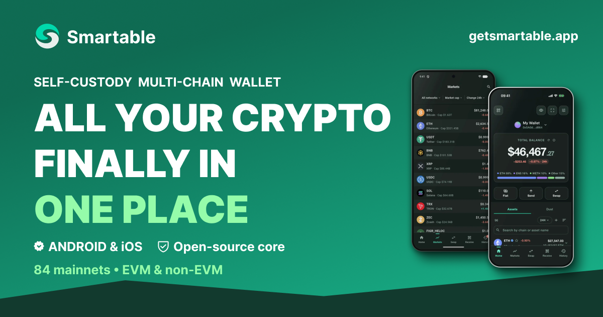

<div align="center">

<a href="https://getsmartable.app"></a>

<br>

[](https://gitlab.com/getsmartable-app/android/-/releases)
[](https://getsmartable.app/get)
[](https://getsmartable.app/security)
[](https://getsmartable.app/networks)
[](#at-a-glance)
[](https://gitlab.com/getsmartable-app/core)
[](https://www.bestpractices.dev/projects/15544)

**[Website](https://getsmartable.app)** ·
**[Download](https://getsmartable.app/get)** ·
**[Docs](https://docs.getsmartable.app)** ·
**[Security](https://getsmartable.app/security)** ·
**[How it's built](https://getsmartable.app/how-its-built)** ·
**[Core source](https://gitlab.com/getsmartable-app/core)** ·
**[Support the author](#support-the-author)**

</div>

---

Smartable Wallet is a self-custody, multi-chain wallet for Android. Each wallet
has its own recovery phrase, and no company holds your coins — not even us.
Recovery phrases and private keys are designed to remain encrypted on your
phone or inside the hardware wallet you connect. There is no backend signer and
no recovery key held by Smartable.

The wallet asks nothing of a blockchain until you connect a network. Balances,
sends and history then go from your phone to that connection alone, never
through Smartable.

## At a glance

| Area | Details |
|---|---|
| **Platform** | Android 11 or later on a 64-bit ARM phone (arm64-v8a), as a direct APK download |
| **Networks** | 84 mainnets: 55 EVM networks, Bitcoin and its family, Solana, TON, XRP Ledger, Cardano, Polkadot, the Cosmos zones, Kaspa, Starknet, the Internet Computer and more — [full list](https://getsmartable.app/networks). Mainnets only: no test networks, no test mode |
| **Accounts** | BIP-39 recovery phrases, several wallets side by side; imported private keys (EVM, TRON, Solana, Bitcoin); Ledger, Trezor and Keystone; watch-only (an EVM address or ENS name, or one Bitcoin address) |
| **Unlock** | Wallet password of 12+ characters, a six-digit app PIN and biometric quick unlock. The phone's own passcode or pattern never opens the wallet |
| **Backup** | Recovery phrase, or a SLIP-39 split backup (2-of-3 or 3-of-5): one share stays on the phone, the others go to Google Drive, MEGA, Backblaze B2 or paper |
| **dApps** | WalletConnect (Reown WalletKit) and a built-in dApp browser |
| **Swaps and bridges** | 0x, LI.FI, Jupiter, THORChain, STON.fi, xExchange, Vestige, Sirius and Stellar's own exchange; bridges through Across, Stargate and CCTP |
| **Languages** | English, Español, Deutsch, Français, Italiano, 简体中文, 日本語, 한국어, Türkçe, Polski, Português, ไทย, Bahasa Indonesia |
| **License** | The app is proprietary; its [core](#open-source-core) is Apache-2.0 |

## How it works

- **Your connection, chosen by you.** Nothing is built in by default. A network
  is connected with your own node-provider account (Alchemy, Infura, Ankr,
  dRPC, Dwellir), an endpoint of your own, or a public endpoint from the
  built-in catalogue, and each is checked against that network's mainnet — its
  chain ID or genesis — before it is stored. Endpoints and keys are encrypted
  on the phone and never sent to Smartable. A network you have not connected is
  asked nothing.
- **A narrow proxy.** One Cloudflare Worker serves swap and bridge quotes and
  routes, route status, Smartable's fee, a short cache of CoinMarketCap prices,
  the on-ramp session and signed list updates. It carries no chain traffic and
  holds no wallet keys. When it is unavailable, those features say so and the
  wallet keeps working.
- **Prices on the device.** An on-device engine reads trading pools through
  your own provider account. Only its prices are used in the checks before
  signing; the CoinMarketCap cache is for display, and each price names its
  source.
- **No AI access.** There is no AI connector, relay, token or background
  access. *Analyze with AI* composes a text with the public addresses you pick,
  and you share it yourself.
- **Quiet by default.** No remote notifications and no Firebase. Crash reports
  are off until you turn them on.

## Before you sign

- **Review.** Network, sender, recipient, asset, amount, network fee and a
  summary of any contract call, with a simulation where the network supports
  one. Unknown calldata is never described as a safe transfer, and `eth_sign`
  is refused.
- **Approvals.** Smartable's own swaps approve exactly the amount traded, never
  an unlimited allowance. An unlimited approval or permit asked for by a dApp
  is named as such and confirmed on its own; where the site cannot be verified,
  it is refused by default.
- **Swaps and bridges.** The recipient, the asset and the minimum received are
  read from what is signed. A cross-chain route is offered only where these
  can be checked on the phone; otherwise it is withheld, not offered with a
  warning. An approval and a swap are always separate confirmations.
- **Screening.** Lookalike addresses are flagged before you send, and addresses
  are checked against official sanctions lists on the device.
- **Modified phones.** On a rooted or jailbroken phone the wallet does not sign
  with keys kept on it, does not connect to dApps and does not create or import
  keys. Balances, history and your recovery phrase stay available.
- **One broadcast.** A transaction whose broadcast result is uncertain is shown
  as pending, and the wallet never offers to send the same payment again.

## How keys are protected

- Secrets are stored encrypted in the platform keystore or not at all — there is
  no plaintext fallback. A secret that cannot be decrypted is reported, never
  deleted.
- Each recovery phrase is sealed under a random key of its own; the password
  only wraps that key. Unlock keys are sealed by Android Keystore (StrongBox
  where present, otherwise the TEE).
- Passwords, PINs and passphrases are normalised to Unicode NFC, then derived
  with PBKDF2-HMAC-SHA256 at 600,000 rounds. Split-backup shares are sealed with
  Argon2id (64 MiB).
- The PIN first passes through a key held in the phone's key store, and every
  place a secret is typed shares one wrong-guess counter. Its wait runs on the
  boot clock, so changing the date does not end a lockout.
- A Rust key core, which keeps the seed and every key derived from it out of
  Dart and checks an EVM transaction's bytes before signing it, is in
  development. Releases do not use it yet.

## Get the app

Android 11 or later on a 64-bit ARM phone. Download from
[getsmartable.app/get](https://getsmartable.app/get) or the
[GitLab releases](https://gitlab.com/getsmartable-app/android/-/releases), and
check the file before installing it:

```bash
shasum -a 256 -c SHA256SUMS            # Linux: sha256sum -c SHA256SUMS
apksigner verify --print-certs smartable-*.apk
```

The signer's certificate SHA-256 must be:

```text
a620bbde76e011db72c5ded72c4c4dc37ab57fb02f91ac840286bd628568e335
```

The same value is published on [getsmartable.app/get](https://getsmartable.app/get)
and in each GitLab release. If any of them differ, do not install the file.

## Open-source core

[Smartable Wallet Core](https://gitlab.com/getsmartable-app/core) publishes the
part of the app that keeps it non-custodial on the phone: how a typed password
becomes key material, where secrets are stored, how the PIN and its lockout
work, how a recovery phrase is split for backup, and the hardware key the
wallet is sealed under. It is licensed under Apache-2.0, and each release comes
with `SHA256SUMS` and a SLSA build-provenance attestation.

No independent security audit has been completed.

## Support the author

Smartable is built and maintained by its author. If the app is useful to you,
you can send a voluntary contribution to one of the addresses below.

<table>
<tr>
<td align="center" width="50%" valign="top">
<b>USDC · USDT</b><br>
Network: Ethereum (ERC-20)<br><br>
<br><br>
<code>0x7f53aC883F250DCff43F957cB86f75f5F09a18Ae</code><br><br>
Send only USDC or USDT, and only on Ethereum. Other tokens or networks may not reach the author.
</td>
<td align="center" width="50%" valign="top">
<b>Bitcoin · BTC</b><br>
Network: Bitcoin<br><br>
<br><br>
<code>bc1qne6cl9lw40fgdnzqcx5hhdn94cnf474tzzclna</code><br><br>
Send only bitcoin, and only on the Bitcoin network. Other coins or networks may not reach the author.
</td>
</tr>
</table>

**Check the address.** The app shows the same Ethereum address under
Settings → About → Support the author, and only after it has checked
Smartable's signature on it. Both addresses are also on
[getsmartable.app/support-the-author](https://getsmartable.app/support-the-author).
Compare them before you send.

**Voluntary.** A contribution is entirely voluntary. It is not a payment for
services and does not unlock features, priority support or any other benefit.
It does not create an entitlement to future development or change how the app
works.

Please check the asset, network and address carefully before sending.
Contributions are not refundable. Do not contribute if you expect anything in
return.

Each party is responsible for their own tax and reporting obligations under
applicable law.

## Security reports

Please report suspected vulnerabilities privately to
[hello@getsmartable.app](mailto:hello@getsmartable.app), not in a public issue.

---

<sub>Smartable™ is non-custodial software. Private keys are designed to remain
on your device, and you are responsible for your own keys. Confirmed blockchain
transactions may be irreversible, and Smartable cannot reverse them. Nothing
here is investment advice. [Terms of Use](https://getsmartable.app/terms) ·
[Privacy Policy](https://getsmartable.app/privacy) ·
[Disclosures](https://getsmartable.app/disclosures)</sub>
